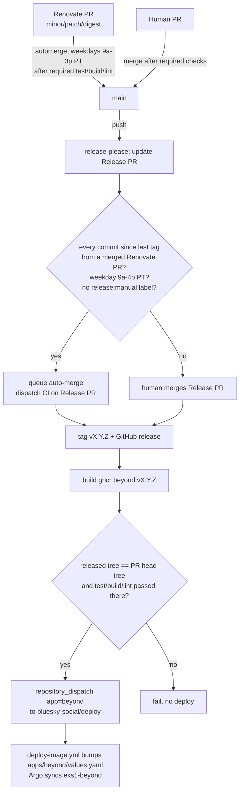

# Release automation: release-please, Renovate, unattended dependency deploys

Status: implemented 2026-10-23. **Generalized 2026-10-27** into the org
pipeline (`bluesky-social/.github`
`docs/plans/2026-10-27-unattended-dependency-releases.md`): the gate scripts,
release-please run and Renovate policy now live there, the Release PR is
maintained and merged by the `bsky-release-bot` App, so the hourly reconcile
cron and CI dispatch below are gone, and Dependabot-authored commits also
count as bot provenance. `automergeSchedule` turned out to be inert with
`platformAutomerge` (Renovate docs), so the weekday window lives only in the
release gate. What stays beyond-specific: the front-door framing and the
deploy-time CI re-check in `deploy-dispatch`.

## Goal

1. Version beyond with release-please, the org's standard
   (dot-github `docs/reference/release-please-onboarding.md`).
2. Take dependency updates from Renovate without a human doing the typing.
3. Cut and deploy releases automatically, but only when full CI passes on
   exactly what ships.

## Constraint that shapes everything

beyond is the front door for every `*.noclues.net` app, including the tools
you'd use to fix a bad beyond deploy (roast, diderot, gcx, nbx, mint). See the
header of `deploy/apps/beyond/values.yaml`. So unattended means unattended
**dependency** releases only. Any human-authored change still needs a human
to merge the Release PR.

## Flow

## Decisions

- **Renovate over Dependabot.** It matches roast's working config (grouped Go
  updates, `gomodTidy`, a 3-day minimum release age, and security fixes that
  skip the wait) and supports `automergeSchedule`. Go minor/major toolchain
  moves are never automerged. The `go.mod` directive only bumps upward, which
  keeps the 1.26.5 floor (see AGENTS.md).
- **Provenance gate, not version gate.** Roast auto-merges only patch bumps.
  Beyond uses `always-bump-patch` (its commits aren't Conventional Commits),
  so every release is a patch and that test can't tell anything apart.
  `.github/scripts/renovate-only-release.sh` instead requires every non-merge
  commit in `v<last>..main` to be associated with a merged `renovate[bot]` PR.
  The association comes from GitHub's commit-to-PR API, not git author
  fields, which anyone can set.
- **Business hours only.** Renovate automerges weekdays 9am–3pm PT. The Release
  PR is queued only weekdays 9am–4pm PT. No unattended Friday-night or weekend
  deploys of the front door.
- **CI gate re-checked at deploy time.** Branch protection on `main` requires
  `test`, `build` and `lint` (strict, up-to-date). Admins can bypass it, so
  `deploy-dispatch` independently checks that the tag's tree is byte-identical
  to a merged PR head whose latest `test`, `build` and `lint` runs all
  succeeded.
- **Deploy through the existing receiver.** It uses the org's
  `bsky-deploy-dispatch` App and `deploy/.github/workflows/deploy-dispatch.yml`,
  not a new cross-repo credential.
- **ghcr, not ECR.** The image stays public at `ghcr.io/bluesky-social/beyond`.
  Releases add a `vX.Y.Z` tag. `container-beyond.yml` keeps tagging every main
  push by SHA.

## Sharp edges

- GITHUB_TOKEN merges (the auto-merged Release PR) don't trigger push
  workflows. The hourly `schedule` in `release-please.yml` turns them into a
  tag and deploy, so a release lands up to an hour after its PR merges.
- GITHUB_TOKEN-created PRs and branch refreshes don't trigger `pull_request`
  CI. The maintenance job dispatches `ci.yml` for the Release PR head.
- Baseline tag `v0.1.0` points at `01a3397` (the brotli deploy). If the manifest
  claims a version with no tag, release-please hard-fails with
  `Invalid previous_tag parameter`.
- Hold a release: put the `release:manual` label on the Release PR.

## Prerequisites (operator or org owner)

- Add beyond to the Renovate GitHub App installation (org owner).
- Set the repo secret `DEPLOY_DISPATCH_APP_KEY` on beyond. The org secret is
  `private` visibility and beyond is public, so it can't see the org copy.
  `DEPLOY_DISPATCH_APP_ID` is already set as a repo secret.
